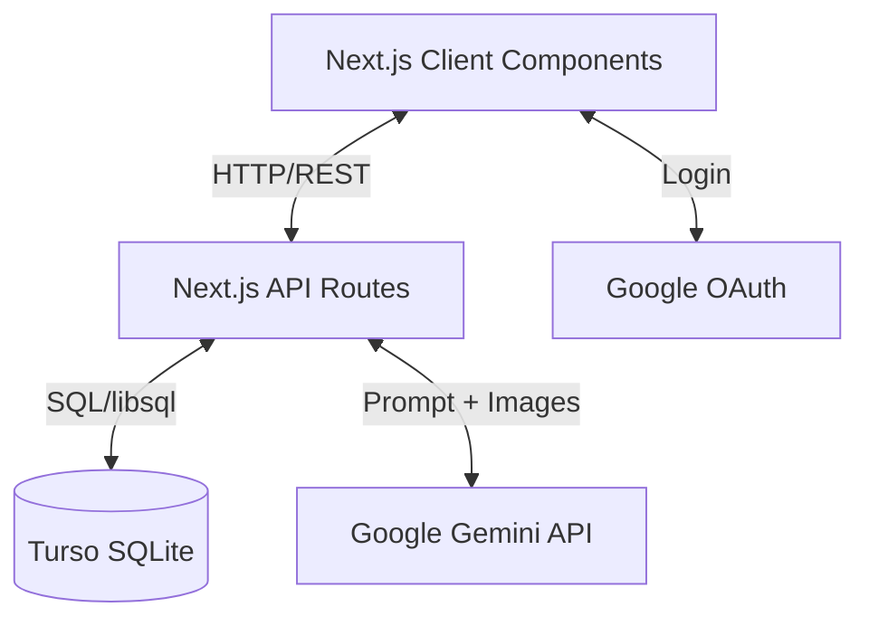
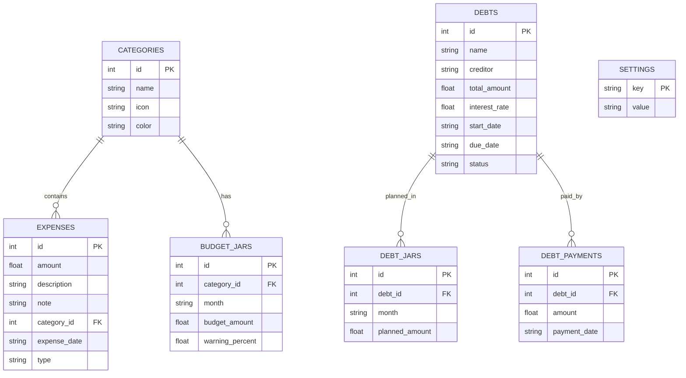

# Software Requirements Specification (SRS)

## 1. Giới thiệu
- **Mục đích**: Tài liệu này mô tả chi tiết các yêu cầu chức năng và phi chức năng cho hệ thống "Chi Tiêu Manager".
- **Phạm vi**: Ứng dụng web/mobile cho phép người dùng cá nhân quản lý tài chính, chi tiêu, công nợ và ngân sách hàng tháng thông qua giao diện truyền thống và tương tác AI tự nhiên.
- **Đối tượng**: Cung cấp thông tin cho các nhà phát triển, người kiểm thử và các bên liên quan để hiểu rõ hệ thống.

## 2. Yêu cầu chức năng

- **F1: Ghi nhận chi tiêu qua AI Chat**
  - Người dùng có thể nhập tin nhắn văn bản (vd: "ăn phở 50k", "nhận lương 15tr").
  - Người dùng có thể dán/tải lên ảnh chụp màn hình giao dịch chuyển khoản ngân hàng hoặc hóa đơn.
  - Hệ thống sử dụng AI (Gemini) để trích xuất: số tiền, mô tả, ngày, đối tác (merchant), và loại (thu/chi).

- **F2: Phân biệt thu nhập/chi tiêu tự động**
  - AI tự động phân tích ngữ cảnh tin nhắn hoặc hình ảnh (+/- tiền, chữ "Nhận", "Thanh toán") để xếp vào nhóm Thu nhập hoặc Chi tiêu.

- **F3: Quản lý chi tiêu**
  - Xem danh sách giao dịch.
  - Thêm, sửa, xóa giao dịch thủ công.
  - Lọc giao dịch theo tháng, danh mục, loại thu/chi.

- **F4: Thống kê**
  - Hiển thị tổng thu, tổng chi, số dư.
  - Biểu đồ chi tiêu theo ngày, tháng, quý, năm (Line chart, Bar chart).
  - Phân tích chi tiêu theo danh mục (Pie chart).

- **F5: Hũ ngân sách (Budget Jars)**
  - Người dùng thiết lập ngân sách tối đa cho từng danh mục theo tháng.
  - Theo dõi tiến độ chi tiêu so với ngân sách.
  - Cảnh báo (màu sắc/icon) khi vượt ngưỡng (ví dụ: >80%).

- **F6: Quản lý công nợ**
  - Thêm khoản vay (vay người khác) hoặc cho vay (người khác vay).
  - Ghi nhận thông tin: người nợ/chủ nợ, tổng số tiền, lãi suất, ngày bắt đầu, ngày đáo hạn.
  - Theo dõi tiến độ trả nợ (số tiền đã trả, số tiền còn lại).

- **F7: Chat AI trả nợ nhanh**
  - Người dùng nhập văn bản để cập nhật tiến độ trả nợ (vd: "trả Hùng 2tr tiền vay tháng trước").
  - AI nhận diện khoản nợ tương ứng và tự động tạo record thanh toán.

- **F8: Cài đặt hệ thống**
  - Nhập và lưu trữ Gemini API key (hỗ trợ nhiều key để fallback).
  - Tùy chỉnh danh mục chi tiêu (thêm, sửa, xóa, đổi icon/màu sắc).
  - Cài đặt cấu hình model AI.

- **F9: Đăng nhập & Xác thực**
  - Đăng nhập an toàn bằng tài khoản Google (thông qua NextAuth).
  - Bảo vệ dữ liệu cá nhân theo từng người dùng.

## 3. Yêu cầu phi chức năng
- **Hiệu năng**: Tốc độ phản hồi từ AI phải dưới 3 giây (với text) và dưới 8 giây (với ảnh). Load trang dưới 1.5 giây.
- **Bảo mật**: API key và thông tin tài chính được lưu trữ an toàn. Xác thực người dùng chặt chẽ, người nào chỉ thấy dữ liệu người đó.
- **UX/UI (Mobile-first)**: Giao diện phải được tối ưu hóa cho màn hình di động, thao tác bằng một tay dễ dàng, hỗ trợ Dark Mode.
- **Độ tin cậy**: Hệ thống AI fallback qua các model/keys khác nhau khi gặp lỗi (429 Quota Exceeded).

## 4. Kiến trúc hệ thống

## 5. Database Schema (ER Diagram)

## 6. API Endpoints
| Endpoint | Method | Mô tả |
|----------|--------|-------|
| `/api/chat` | POST | Gửi tin nhắn/ảnh cho AI để tạo expense/debt payment |
| `/api/expenses` | GET, POST | Quản lý danh sách chi tiêu |
| `/api/expenses/[id]` | PUT, DELETE | Cập nhật/Xóa chi tiêu |
| `/api/expenses/stats` | GET | Lấy thống kê tổng quan, biểu đồ |
| `/api/budgets` | GET, POST | Lấy/Tạo ngân sách (hũ) |
| `/api/categories` | GET, POST, PUT, DELETE| Quản lý danh mục |
| `/api/debts` | GET, POST | Quản lý khoản nợ |
| `/api/debts/[id]/payments`| GET, POST | Lịch sử trả nợ |
| `/api/settings` | GET, POST | Lấy/Cập nhật cài đặt (API Key, v.v.) |
