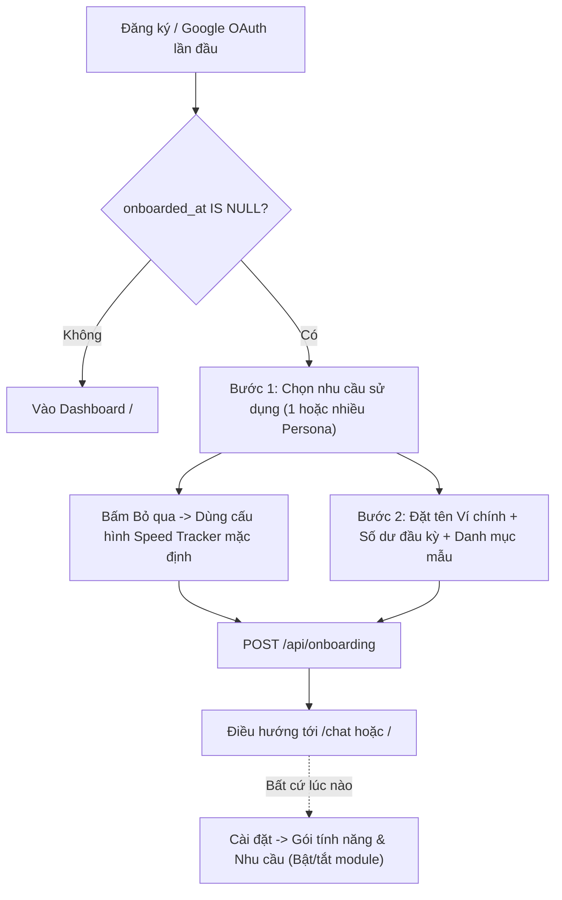
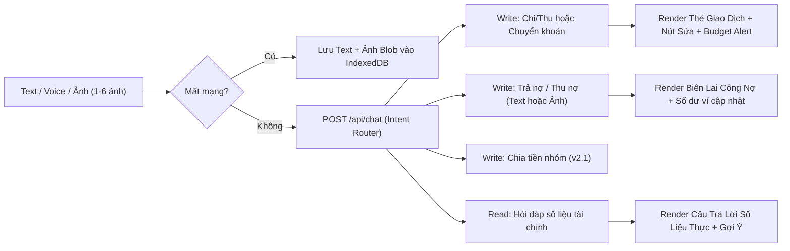

# Luồng Người Dùng & Đặc Tả Màn Hình (UX Flows & Progressive Disclosure)

## 1. Bản đồ Điều hướng Tổng thể (Desktop & Mobile)

Nguyên tắc thiết kế giữ nguyên sự gọn nhẹ của `v1.2.2`:
- **Mobile (`< 768px`)**: Giữ 4 tab + nút `+ Ghi nhanh` ở giữa BottomNav (`Tổng quan`, `Giao dịch`, `Kế hoạch`, `Tài khoản`). Các màn nâng cao mở qua link ngữ cảnh hoặc Settings.
- **Desktop (`>= 768px`)**: Sidebar trái giữ các mục chính (`Tổng quan`, `Giao dịch`, `Ngân sách`, `Công nợ`, `Thống kê`, `Cài đặt`), bổ sung **Ledger Switcher** (chỉ hiện khi module `shared_ledgers` bật và user có >= 2 sổ).

---

## 2. Luồng Onboarding & Nâng cấp Module trong Cài đặt

### Chi tiết UX tại `/settings` (Phần nâng cấp nhu cầu):
- Có 1 card riêng **"Nhu cầu & Tính năng mở rộng"** đặt ngay dưới Hồ sơ tài khoản:
  - Hiển thị **Persona Preset** (chọn nhanh 1 trong 6 mẫu để auto-toggle bộ switch).
  - Danh sách **Module Toggles** rõ ràng từng mục (`Đa ví & Chuyển khoản`, `Ngân sách nâng cao: Rollover & Auto-Split`, `Công nợ 2 chiều & Mô phỏng trả nợ`, `Nhắc lịch định kỳ`, `Thống kê Cashflow Pro`, `Sổ chung & Kinh doanh [v2.1]`).
  - Khi tắt 1 module, hiện chú thích: *"Dữ liệu đã lưu vẫn được giữ nguyên, chỉ ẩn khỏi giao diện"*.

---

## 3. Luồng Chat Hợp nhất (`/chat` — thay thế cả `/debt-chat`)

Route `/debt-chat` chuyển thành redirect `308` sang `/chat?mode=debt` để giữ tương thích bookmark cũ, đồng thời mọi tương tác AI gom về **1 giao diện duy nhất**:

### Quy chuẩn UX trong `/chat`:
- **Ghi 1 chạm từ gợi ý**: Gợi ý top giao dịch lặp lại + nút mẫu nhanh (`Chuyển khoản`, `Trả nợ`, `Hỏi tháng này tiêu gì`).
- **Sửa nhanh sau khi lưu**: Nếu Fast-Path 0ms phân loại chưa đúng ý (VD: user nói `"mua đồ 200k"`), bấm **Sửa** ngay trên thẻ → đổi danh mục → hệ thống hiển thị chip nhỏ `"Luôn xếp 'mua đồ' vào danh mục này?"` (1 chạm lưu `merchant_rules`).
- **Tài khoản/Ví mặc định**: Khi bật `multi_account`, có pill chọn nhanh ví đang dùng ngay trên thanh composer (mặc định là ví vừa dùng gần nhất hoặc Ví chính).

---

## 4. Luồng Trang Giao dịch (`/expenses`) — Sửa UX Mobile & Mở rộng

- **Mobile Search Fix**: Thanh tìm kiếm luôn hiển thị dưới header (không ẩn bằng `hidden lg:block`).
- **Filter Bar ngang**:
  - Chip chọn **Kỳ** (`MonthPicker` hoặc `Tùy chọn từ ngày–đến ngày`).
  - Chip lọc **Loại** (`Tất cả` | `Chi` | `Thu` | `Chuyển khoản`).
  - Chip lọc **Ví** (khi bật `multi_account`) và **Danh mục** / **#Tag** (v2.1).
- **Bulk Actions & Export**:
  - Nút **Export CSV** (xuất đúng tập giao dịch đang lọc) và **Import CSV** đặt ở menu góc phải.
  - Bảng desktop và danh sách mobile hỗ trợ **cursor pagination ("Tải thêm")** khi quá 50 giao dịch/lần tải.

---

## 5. Luồng Ngân sách (`/budgets`) & Nhắc hẹn Định kỳ (Opt-in)

1. **Hũ ngân sách (Opt-in Rollover)**:
   - Form tạo/sửa hũ giữ tối giản ở phần trên; phần **"Tùy chọn nâng cao"** (collapsible) chứa:
     - Cảnh báo `%`, Hạn mức ngày (`daily_limit`), Tần suất (`frequency_limit`).
     - Checkbox **"Chuyển số dư còn lại sang tháng sau (Rollover)"** (chỉ hiện hoặc nhấn mạnh khi bật `budget_advanced`) với 2 lựa chọn: *Chỉ chuyển số dương* / *Chuyển cả số âm (bù lố)*.
2. **Payday Auto-Split**:
   - Ngay khi user lưu giao dịch `Thu nhập` (hoặc bấm nút *"Chia ngân sách từ thu nhập"* trên `/budgets`), mở sheet gợi ý phân bổ số tiền đó vào các hũ theo tỷ lệ `%` (VD: 50% Thiết yếu / 30% Mong muốn / 20% Tiết kiệm-Trả nợ) và áp dụng chỉ với 1 lần xác nhận.
3. **Nhắc hẹn Định kỳ (`recurring_rules` — Notify-Only)**:
   - Khi tới ngày hẹn, cron chỉ **gửi Web Push** và đánh dấu bản ghi `pending_occurrences`.
   - Tại Dashboard hoặc đầu trang Giao dịch hiện banner **"Khoản đến hẹn cần xác nhận (N)"**:
     - Nút **Ghi nhận** (cho phép chỉnh nhanh số tiền thực tế như hóa đơn điện/nước rồi lưu thành giao dịch thật).
     - Nút **Bỏ qua kỳ này** hoặc **Hoãn 3 ngày**.

---

## 6. Luồng Công nợ 2 chiều (`/debts` & `/debts/[id]`)

- **Phân tách rõ 2 tab chính**:
  - **Tôi đi vay (Payable)**: Tiền mình nợ ngân hàng, người thân, thẻ tín dụng, đào góp.
  - **Cho vay / Phải thu (Receivable)**: Tiền người khác nợ mình hoặc tiền ứng trước cần thu hồi.
- **Modal Trả nợ / Thu nợ**:
  - Checkbox **"Cập nhật số dư ví"** mặc định **BẬT** (`checked = true`), kèm dropdown chọn ví nguồn/đích.
  - Cho phép bỏ tick nếu user chỉ muốn ghi nhận lại lịch sử trả nợ cũ mà không làm thay đổi số dư ví hiện tại.
- **Tab Mô phỏng thoát nợ (Payoff Simulator)** *(khi bật `debt_two_way`)*:
  - Nhập `Ngân sách trả nợ hàng tháng` → hiện bảng so sánh **Avalanche** vs **Snowball**: *Tháng sạch nợ dự kiến*, *Tổng lãi phải trả*, *Thứ tự ưu tiên từng khoản*.

---

## 7. Luồng Dashboard (`/`) — Thích ứng theo Module

- **Lớp 1 (Luôn hiện)**: Card Số dư tổng + Thu/Chi tháng này; Giao dịch gần đây; Cảnh báo vượt ngân sách; Card AI nhìn lại tuần.
- **Lớp 2 (Hiện theo Module bật)**:
  - `multi_account = ON`: Thanh trượt ngang các **Ví** dưới Card Số dư tổng (bấm vào ví để lọc nhanh giao dịch ví đó).
  - `budget_advanced = ON`: Badge **Safe-to-Spend hôm nay** ngay trong Card tổng quan.
  - `recurring_reminders = ON`: Banner **Khoản định kỳ chờ duyệt** (chỉ hiện khi có item đến hạn).
  - `debt_two_way = ON`: Thẻ tóm tắt **Nợ sắp đến hạn (trong 7 ngày)**.
