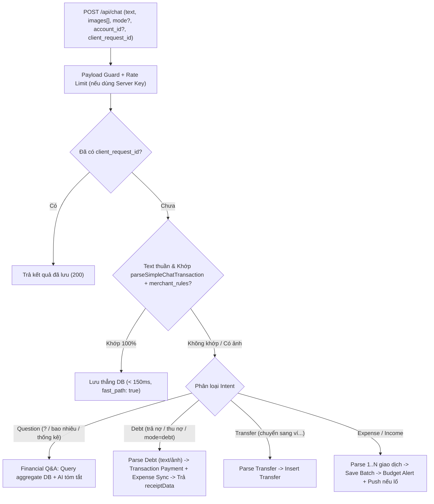

# Đặc tả API Contracts & Kiến trúc AI Router — ARC Irobot v2.1

Mọi endpoint đều tuân thủ:
- Xác thực qua `getCurrentUser()` (hoặc `Bearer <shortcut_token>` cho Shortcuts API, `Bearer <CRON_SECRET>` cho Cron).
- Kiểm tra quyền sở hữu sổ (`assertLedgerAccess(db, user.id, ledgerId, minRole)`).
- Validate input bằng **Zod**; lỗi trả `{ error: string, code?: string }` kèm đúng HTTP status (`400`, `401`, `403`, `404`, `409`, `413`, `422`, `429`).

---

## 1. Nhóm Auth, Onboarding & Profile Modules

| Endpoint | Method | Chức năng & Contract |
| :--- | :--- | :--- |
| `/api/auth/forgot-password` | `POST` | Input `{ email }`. Rate limit `5/15m/IP`. Nếu tìm thấy user: tạo token 32B, lưu `SHA-256` vào `auth_tokens` (TTL 30m), gửi mail qua Nodemailer (`src/lib/mailer.ts`). Luôn trả `200 { ok: true }` tránh dò email. |
| `/api/auth/reset-password` | `POST` | Input `{ token, password (>=10 chars) }`. Kiểm tra token chưa dùng & còn hạn → hash `scrypt` → update `users.password_hash` + set `used_at` trong transaction. |
| `/api/profile` | `GET`, `PATCH` | `GET`: trả `{ id, name, email, image, onboardedAt, persona, personas, modules, activeLedgerId }`.<br>`PATCH`: cập nhật `name`, `personas`, `enabledModules`, `activeLedgerId`, hoặc đổi mật khẩu (`currentPassword`, `newPassword`). |
| `/api/onboarding` | `POST` | Input `{ primaryPersona, personas[], mainAccountName, initialBalance, additionalAccounts[], seedPack }`. Khởi tạo ví, danh mục theo pack, lưu `user_profiles` và set `users.onboarded_at`. |

---

## 2. Nhóm Accounts (Đa ví) & Giao dịch (Phân trang + Transfer)

### 2.1 Accounts API
- `GET /api/accounts`: Trả danh sách ví thuộc `activeLedgerId` kèm số dư tính toán realtime:
  ```sql
  balance = initial_balance
    + SUM(CASE WHEN type = 'income' AND account_id = a.id THEN amount ELSE 0 END)
    - SUM(CASE WHEN type = 'expense' AND account_id = a.id THEN amount ELSE 0 END)
    + SUM(CASE WHEN type = 'transfer' AND to_account_id = a.id THEN amount ELSE 0 END)
    - SUM(CASE WHEN type = 'transfer' AND account_id = a.id THEN amount ELSE 0 END)
  ```
- `POST /api/accounts`: Tạo ví (`name`, `type`, `initial_balance`, `credit_limit`, `statement_day`, `due_day`, `is_default`).
- `PATCH /api/accounts/[id]`: Cập nhật tên, mặc định hoặc `archived = 1`.

### 2.2 Expenses & Transfers API (`/api/expenses`)
- `GET /api/expenses`:
  - Query params: `month`, `from`, `to`, `type` (`all|expense|income|transfer`), `account_id`, `category_id`, `tag`, `search`, `cursor` (`expense_date:id`), `limit` (default `50`, max `100`).
  - Response:
    ```json
    {
      "items": [...],
      "nextCursor": "2026-11-12:412",
      "summary": { "totalIncome": 15000000, "totalExpense": 4200000, "net": 10800000 }
    }
    ```
  - Lưu ý: `summary` tính bằng SQL aggregate trên toàn tập lọc (loại trừ `type = 'transfer'`), tách khỏi `LIMIT` của `items`.
- `POST /api/expenses`:
  - Khi `type = 'transfer'`: bắt buộc `account_id !== to_account_id`, `category_id` cho phép `null`, không chạy `getBudgetAlert`.
  - Khi `type = 'expense' | 'income'`: validate `category_id` thuộc sổ/hệ thống và khớp `kind`.
  - Dùng `ON CONFLICT(user_id, client_request_id) DO NOTHING` thay cho `INSERT OR IGNORE`.
- `PUT /api/expenses/[id]`:
  - Đọc bản ghi cũ trước khi update → tính chính xác `addedAmount = newAmount - oldSameBucketAmount` trước khi gọi `getBudgetAlert`.

---

## 3. Nhóm Budgets (Opt-in Rollover & Payday Auto-Split)

- `POST /api/budgets` & `PUT /api/budgets/[id]`:
  - Đồng bộ cập nhật đủ tất cả cột: `budget_amount`, `budget_basis`, `daily_amount`, `budget_days`, `warning_percent`, `daily_limit`, `frequency_limit`, `frequency_period`, `rollover_enabled`, `rollover_mode`.
- `POST /api/budgets/copy`:
  - Khi copy từ `from_month` sang `to_month`: nếu hũ có `rollover_enabled = 1`, tính `remaining = (budget_amount + rollover_amount) - spent_amount(from_month)`:
    - `rollover_mode = 'positive_only'`: `new_rollover = Math.max(0, remaining)`.
    - `rollover_mode = 'all'`: `new_rollover = remaining`.
- `POST /api/budgets/payday-split`:
  - Input `{ totalIncomeAmount, allocations: [{ category_id, percent }] }` (tổng `<= 100%`). Trả preview hoặc áp dụng tạo/cộng hạn mức cho các hũ tháng hiện tại.

---

## 4. Nhóm Công nợ 2 chiều, Thanh toán đồng bộ Ví & Simulator

- `POST /api/debts` & `PUT /api/debts/[id]`:
  - Validate bằng Zod (`direction: 'payable' | 'receivable'`, `total_amount > 0`, `interest_rate >= 0`, `start_date <= due_date`, `status: 'active' | 'completed'`).
- `GET /api/debts/[id]/payments`:
  - Trả chuẩn `payment_date`, `amount`, `note`, `account_id`, `expense_id` (sửa contract lệch ở `debts/[id]/page.tsx`).
- `POST /api/debts/[id]/payments`:
  - Input `{ amount, payment_date, note, account_id, sync_to_expense = true }`.
  - Chạy trong `db.transaction('write')`:
    1. Nếu `sync_to_expense === true`: insert vào `expenses` (`type = debt.direction === 'payable' ? 'expense' : 'income'`, `account_id`, `description = "Trả nợ: ..." / "Thu nợ: ..."`).
    2. Insert vào `debt_payments` (gắn `expense_id`).
    3. Recalculate tổng đã trả → cập nhật `debts.status = 'completed' | 'active'`.
- `DELETE /api/debts/[id]/payments/[paymentId]`:
  - Xóa payment + xóa `expense_id` liên kết (nếu user chọn) + tính lại trạng thái `debts.status`.
- `GET /api/debts/jars`: Trả chuẩn `planned_amount` và `actual_paid` (khớp UI).
- `POST /api/debts/simulate`:
  - Input `{ monthlyBudget, strategy: 'avalanche' | 'snowball' }` → trả lịch trình trả từng tháng, tháng tất toán từng khoản và tổng lãi ước tính.

---

## 5. Nhóm Recurring Reminders (Notify-Only)

- `GET / POST /api/recurring` & `PATCH / DELETE /api/recurring/[id]`:
  - Quản lý quy tắc nhắc hẹn (`title, amount, type, category_id, account_id, debt_id, cadence, day_of_month, next_due_date`).
- `GET /api/recurring/pending`: Lấy danh sách `recurring_occurrences` đang `status = 'pending'`.
- `POST /api/recurring/occurrences/[id]/confirm`:
  - Input `{ amount?, account_id?, expense_date?, note? }` (user có thể sửa số tiền thực tế trước khi duyệt).
  - Trong transaction: tạo `expenses` thật (hoặc `debt_payments` nếu `type = 'debt_payment'`), update occurrence → `'confirmed'`, tính `next_due_date` kỳ tiếp theo.
- `POST /api/recurring/occurrences/[id]/skip`: Đánh dấu `'skipped'` và dời `next_due_date`.

---

## 6. Nhóm Unified AI Chat, Fast-Path 0ms, Whisper & Shortcuts API

### 6.1 AI Intent Router (`/api/chat`)


### 6.2 Quy tắc AI Provider & Whisper (`/api/chat/transcribe`)
- **Timeout Budget**:
  - `callConfiguredAi`: Primary model timeout `12s`; tối đa `1` fallback model `10s` (không nối thêm 3 model mặc định nếu user đã chọn model cụ thể trên provider custom).
  - Nếu lỗi `401/403` từ provider BYOK hoặc fail toàn bộ, fallback sang `GEMINI_API_KEY` server (giữ chế độ B theo yêu cầu ĐẠI CA).
- **Whisper Audio Support**:
  - Khi active provider có `protocol = 'openai_compatible'` (OpenAI, Groq), `transcribeAudio` gửi multipart `file` + `model` (`whisper-1` cho OpenAI hoặc `whisper-large-v3-turbo` cho Groq) tới `${baseUrl}/audio/transcriptions` thay vì trả `null`.

### 6.3 Apple Shortcuts API
- `GET / POST /api/shortcuts/keys` & `DELETE /api/shortcuts/keys/[id]`: Quản lý API token cá nhân.
- `POST /api/shortcuts/transactions`:
  - Header: `Authorization: Bearer arc_sk_...`.
  - Hỗ trợ `application/json` (`{ text, amount?, description?, account_id?, client_request_id? }`) hoặc `multipart/form-data` (`images`, `message`).
  - Xác định user từ `key_hash`, chạy chung pipeline xử lý của `/api/chat`, trả về JSON gọn nhẹ tối ưu cho Apple Shortcuts đọc thông báo (`{ ok: true, summaryText: "Đã ghi 45.000đ · Ăn uống", transactions, budgetAlerts }`).

---

## 7. Nhóm Import / Export & Backup

- `GET /api/export?format=csv|json&...filters`:
  - `format=json`: Full account backup (giữ tương thích cũ + thêm `accounts`, `recurringRules`, `tags`).
  - `format=csv`: Xuất bảng giao dịch theo bộ lọc hiện tại (`Ngày, Loại, Ví, Danh mục, Mô tả, Ghi chú, Số tiền`), prefix UTF-8 BOM (`\uFEFF`) để Excel mở không lỗi font tiếng Việt.
- `POST /api/import/csv`: Nhận các dòng sao kê đã map ở UI (`{ accountId, rows: [{ date, amount, description, type }] }`), check trùng lặp (`date + amount + normalized_description`), tự phân loại bằng `merchant_rules` + AI batch, lưu vào DB.
- `POST /api/import/restore`: Validate JSON backup bằng Zod, hỗ trợ mode `merge` (bỏ qua record trùng) hoặc `replace` (trong transaction).
