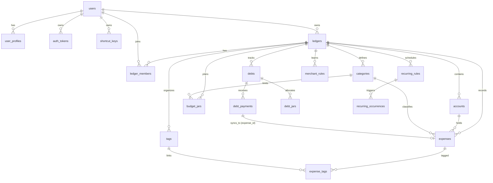

# Thiết kế Cơ sở Dữ liệu & Chiến lược Migration (v1.2.2 → v2.1)

## 1. Sơ đồ quan hệ thực thể (ERD)



---

## 2. Chi tiết thay đổi Schema từ `v1.2.2`

### 2.1 Sửa đổi các bảng hiện có (`v1.2.2`)

1. **`users`**:
   - Giữ các cột cũ (`id, email, name, avatar, password_hash, created_at, updated_at`).
   - Bổ sung:
     - `onboarded_at TEXT` *(NULL = user chưa qua màn Onboarding)*.
     - `email_verified_at TEXT` *(phục vụ xác thực email / mời sổ chung)*.

2. **`categories`**:
   - **Sửa lỗi CRITICAL**: Tạo lại bảng không còn `UNIQUE(name)` toàn cục; dùng 2 partial unique index theo `ledger_id`/`user_id`.
   - Bổ sung:
     - `ledger_id INTEGER REFERENCES ledgers(id) ON DELETE CASCADE` *(NULL cho danh mục hệ thống mặc định)*.
     - `kind TEXT NOT NULL DEFAULT 'expense'` (`'expense' | 'income' | 'both'`).
     - `budget_group TEXT NOT NULL DEFAULT 'wants'` (`'needs' | 'wants' | 'savings'` — hỗ trợ 50/30/20 & Payday Split).
   - Cập nhật seed mặc định: set `'Thu nhập'` có `kind = 'income'`, bổ sung tùy chọn seed `'Lương'`, `'Thưởng'`, `'Thu nhập phụ'` khi onboarding.

3. **`expenses`** (đóng vai trò bảng Sổ cái Giao dịch thống nhất):
   - Giữ các cột cũ (`id, user_id, amount, description, note, category_id, expense_date, type, client_request_id, created_at`).
   - Cho phép `category_id INTEGER` **NULLABLE** khi `type = 'transfer'`.
   - Bổ sung:
     - `ledger_id INTEGER NOT NULL REFERENCES ledgers(id) ON DELETE CASCADE`
     - `account_id INTEGER REFERENCES accounts(id)` *(Ví nguồn / Ví nhận tiền)*
     - `to_account_id INTEGER REFERENCES accounts(id)` *(Chỉ dùng khi `type = 'transfer'`)*
     - `type TEXT NOT NULL DEFAULT 'expense'` mở rộng hỗ trợ `'expense' | 'income' | 'transfer'`.
     - `currency TEXT NOT NULL DEFAULT 'VND'` *(giữ chỗ mở rộng đa tiền tệ sau này)*.
     - `created_by_user_id INTEGER REFERENCES users(id)` *(ai nhập trong sổ chung)*.
     - `reimburse_status TEXT NOT NULL DEFAULT 'none'` (`'none' | 'pending' | 'settled'` — cho nhóm Micro-Business/Pro v2.1).
     - `source TEXT NOT NULL DEFAULT 'web'` (`'web' | 'chat' | 'voice' | 'shortcut' | 'recurring' | 'import'`).

4. **`budget_jars`**:
   - Bổ sung:
     - `ledger_id INTEGER NOT NULL REFERENCES ledgers(id) ON DELETE CASCADE`
     - `rollover_enabled INTEGER NOT NULL DEFAULT 0` *(opt-in checkbox)*
     - `rollover_mode TEXT NOT NULL DEFAULT 'positive_only'` (`'positive_only' | 'all'`)
     - `rollover_amount REAL NOT NULL DEFAULT 0` *(số dư chuyển từ tháng trước sang)*
   - Đổi `UNIQUE(user_id, category_id, month)` → `UNIQUE(ledger_id, category_id, month)`.

5. **`debts` & `debt_payments` & `debt_jars`**:
   - **`debts`**: bổ sung `ledger_id`, `direction TEXT NOT NULL DEFAULT 'payable'` (`'payable' | 'receivable'`), `account_id INTEGER` (ví mặc định khi trả/thu nợ).
   - **`debt_payments`**: bổ sung `ledger_id`, `account_id INTEGER`, `expense_id INTEGER REFERENCES expenses(id) ON DELETE SET NULL` (liên kết trực tiếp giao dịch ví tương ứng!).
   - **`debt_jars`**: bổ sung `ledger_id`, đổi unique sang `(ledger_id, debt_id, month)`.

---

### 2.2 Các bảng mới cần tạo

```sql
-- 1. Hồ sơ phân khúc & Module Flags (Progressive Disclosure)
CREATE TABLE IF NOT EXISTS user_profiles (
  user_id INTEGER PRIMARY KEY REFERENCES users(id) ON DELETE CASCADE,
  primary_persona TEXT NOT NULL DEFAULT 'speed_tracker',
  personas_json TEXT NOT NULL DEFAULT '["speed_tracker"]',
  enabled_modules_json TEXT NOT NULL DEFAULT '{}',
  active_ledger_id INTEGER,
  updated_at TEXT NOT NULL DEFAULT (datetime('now'))
);

-- 2. Token bảo mật (Reset Password / Email Verify / Invite)
CREATE TABLE IF NOT EXISTS auth_tokens (
  id INTEGER PRIMARY KEY AUTOINCREMENT,
  user_id INTEGER REFERENCES users(id) ON DELETE CASCADE,
  email TEXT NOT NULL,
  purpose TEXT NOT NULL, -- 'password_reset' | 'email_verify' | 'ledger_invite'
  token_hash TEXT NOT NULL UNIQUE,
  metadata_json TEXT DEFAULT '{}',
  expires_at TEXT NOT NULL,
  used_at TEXT,
  created_at TEXT NOT NULL DEFAULT (datetime('now'))
);

-- 3. Sổ tài chính (v2.0 dùng 1 sổ Personal mặc định; v2.1 mở rộng Shared/Business)
CREATE TABLE IF NOT EXISTS ledgers (
  id INTEGER PRIMARY KEY AUTOINCREMENT,
  owner_id INTEGER NOT NULL REFERENCES users(id) ON DELETE CASCADE,
  name TEXT NOT NULL DEFAULT 'Ví cá nhân',
  kind TEXT NOT NULL DEFAULT 'personal', -- 'personal' | 'family' | 'business'
  currency TEXT NOT NULL DEFAULT 'VND',
  created_at TEXT NOT NULL DEFAULT (datetime('now'))
);

CREATE TABLE IF NOT EXISTS ledger_members (
  ledger_id INTEGER NOT NULL REFERENCES ledgers(id) ON DELETE CASCADE,
  user_id INTEGER NOT NULL REFERENCES users(id) ON DELETE CASCADE,
  role TEXT NOT NULL DEFAULT 'owner', -- 'owner' | 'editor' | 'viewer'
  joined_at TEXT NOT NULL DEFAULT (datetime('now')),
  PRIMARY KEY (ledger_id, user_id)
);

-- 4. Tài khoản / Ví nguồn tiền
CREATE TABLE IF NOT EXISTS accounts (
  id INTEGER PRIMARY KEY AUTOINCREMENT,
  ledger_id INTEGER NOT NULL REFERENCES ledgers(id) ON DELETE CASCADE,
  user_id INTEGER NOT NULL REFERENCES users(id) ON DELETE CASCADE,
  name TEXT NOT NULL,
  type TEXT NOT NULL DEFAULT 'cash', -- 'cash' | 'bank' | 'ewallet' | 'credit_card' | 'savings'
  initial_balance REAL NOT NULL DEFAULT 0,
  credit_limit REAL NOT NULL DEFAULT 0,
  statement_day INTEGER DEFAULT 0, -- 1..28 cho thẻ tín dụng
  due_day INTEGER DEFAULT 0,
  is_default INTEGER NOT NULL DEFAULT 0,
  archived INTEGER NOT NULL DEFAULT 0,
  created_at TEXT NOT NULL DEFAULT (datetime('now'))
);

-- 5. Quy tắc tự động phân loại cho Fast-Path 0ms
CREATE TABLE IF NOT EXISTS merchant_rules (
  id INTEGER PRIMARY KEY AUTOINCREMENT,
  ledger_id INTEGER NOT NULL REFERENCES ledgers(id) ON DELETE CASCADE,
  user_id INTEGER NOT NULL REFERENCES users(id) ON DELETE CASCADE,
  keyword TEXT NOT NULL, -- normalized lowercase
  category_id INTEGER NOT NULL REFERENCES categories(id) ON DELETE CASCADE,
  type TEXT NOT NULL DEFAULT 'expense',
  account_id INTEGER REFERENCES accounts(id) ON DELETE SET NULL,
  hit_count INTEGER NOT NULL DEFAULT 1,
  updated_at TEXT NOT NULL DEFAULT (datetime('now')),
  UNIQUE(ledger_id, keyword, type)
);

-- 6. Nhắc hẹn giao dịch định kỳ (Notify-Only -> 1-tap confirm)
CREATE TABLE IF NOT EXISTS recurring_rules (
  id INTEGER PRIMARY KEY AUTOINCREMENT,
  ledger_id INTEGER NOT NULL REFERENCES ledgers(id) ON DELETE CASCADE,
  user_id INTEGER NOT NULL REFERENCES users(id) ON DELETE CASCADE,
  title TEXT NOT NULL,
  amount REAL NOT NULL,
  type TEXT NOT NULL DEFAULT 'expense', -- 'expense' | 'income' | 'debt_payment'
  category_id INTEGER REFERENCES categories(id),
  account_id INTEGER REFERENCES accounts(id),
  debt_id INTEGER REFERENCES debts(id) ON DELETE CASCADE,
  cadence TEXT NOT NULL DEFAULT 'monthly', -- 'weekly' | 'monthly' | 'yearly'
  day_of_month INTEGER DEFAULT 1,
  day_of_week INTEGER DEFAULT 1,
  next_due_date TEXT NOT NULL,
  remind_days_before INTEGER NOT NULL DEFAULT 0,
  enabled INTEGER NOT NULL DEFAULT 1,
  created_at TEXT NOT NULL DEFAULT (datetime('now'))
);

CREATE TABLE IF NOT EXISTS recurring_occurrences (
  id INTEGER PRIMARY KEY AUTOINCREMENT,
  rule_id INTEGER NOT NULL REFERENCES recurring_rules(id) ON DELETE CASCADE,
  user_id INTEGER NOT NULL REFERENCES users(id) ON DELETE CASCADE,
  due_date TEXT NOT NULL,
  status TEXT NOT NULL DEFAULT 'pending', -- 'pending' | 'confirmed' | 'skipped'
  expense_id INTEGER REFERENCES expenses(id) ON DELETE SET NULL,
  notified_at TEXT,
  resolved_at TEXT,
  UNIQUE(rule_id, due_date)
);

-- 7. Apple Shortcuts / Webhook API Keys
CREATE TABLE IF NOT EXISTS shortcut_keys (
  id INTEGER PRIMARY KEY AUTOINCREMENT,
  user_id INTEGER NOT NULL REFERENCES users(id) ON DELETE CASCADE,
  ledger_id INTEGER NOT NULL REFERENCES ledgers(id) ON DELETE CASCADE,
  default_account_id INTEGER REFERENCES accounts(id) ON DELETE SET NULL,
  name TEXT NOT NULL,
  key_prefix TEXT NOT NULL,
  key_hash TEXT NOT NULL UNIQUE,
  last_used_at TEXT,
  revoked_at TEXT,
  created_at TEXT NOT NULL DEFAULT (datetime('now'))
);

-- 8. Tagging (v2.1 Pro / Micro-Business)
CREATE TABLE IF NOT EXISTS tags (
  id INTEGER PRIMARY KEY AUTOINCREMENT,
  ledger_id INTEGER NOT NULL REFERENCES ledgers(id) ON DELETE CASCADE,
  name TEXT NOT NULL,
  color TEXT NOT NULL DEFAULT '#64748b',
  UNIQUE(ledger_id, name)
);

CREATE TABLE IF NOT EXISTS expense_tags (
  expense_id INTEGER NOT NULL REFERENCES expenses(id) ON DELETE CASCADE,
  tag_id INTEGER NOT NULL REFERENCES tags(id) ON DELETE CASCADE,
  PRIMARY KEY (expense_id, tag_id)
);
```

---

## 3. Chiến lược Migration an toàn (Zero Data Loss từ `v1.2.2`)

Vì hệ thống đang chạy trên Turso production với dữ liệu thực của ĐẠI CA/users hiện tại, migration phải đảm bảo **idempotent** và **không làm mất dữ liệu cũ**:

1. **Bước 1 — Rebuild `categories` an toàn**:
   - Tạo bảng `categories_v2` (bỏ `UNIQUE` ở cột `name`, thêm `ledger_id`, `kind`, `budget_group`), copy toàn bộ dòng từ `categories` giữ nguyên `id` để **không gãy khóa ngoại** ở `expenses` và `budget_jars`.
   - Swap `categories` → `categories_legacy` → `categories_v2` → tạo 2 partial unique index.
2. **Bước 2 — Backfill mỗi `user` hiện có thành `1 Ledger + 1 Default Account`**:
   - Với mọi user trong `users` chưa có row ở `ledgers`:
     - Insert `ledgers (owner_id, name = 'Ví cá nhân', kind = 'personal')`.
     - Insert `ledger_members (ledger_id, user_id, role = 'owner')`.
     - Insert `accounts (ledger_id, user_id, name = 'Ví chính', type = 'cash', initial_balance = 0, is_default = 1)`.
     - Insert `user_profiles (user_id, primary_persona = 'speed_tracker', active_ledger_id = ledger.id)`. *(Với user cũ đang có dữ liệu, có thể đặt `onboarded_at = datetime('now')` để không ép onboarding lại, hoặc cho banner giới thiệu tính năng mới)*.
3. **Bước 3 — Gắn `ledger_id` & `account_id` cho dữ liệu lịch sử**:
   - Update `expenses`, `budget_jars`, `debts`, `debt_jars`, `debt_payments`, `categories (user_id IS NOT NULL)` gán `ledger_id` theo sổ mặc định của `user_id`.
   - Update `expenses.account_id` và `expenses.created_by_user_id` từ tài khoản mặc định và `user_id`.
4. **Bước 4 — Đánh `SCHEMA_VERSION = '2026-11-v2.0'`**:
   - Đánh index tối ưu cho phân trang & lọc:
     - `idx_expenses_ledger_date_id ON expenses(ledger_id, expense_date DESC, id DESC)`
     - `idx_expenses_account_type ON expenses(account_id, type, expense_date)`
     - `idx_recurring_due ON recurring_rules(enabled, next_due_date)`
     - `idx_shortcut_hash ON shortcut_keys(key_hash)`
   - Cập nhật `resetAccountData` trong [reset-account-data.ts](file:///Users/hominhoanh/Documents/source/APP-CHI-TIEU/src/lib/reset-account-data.ts) xóa sạch toàn bộ bảng mới theo đúng thứ tự FK.
