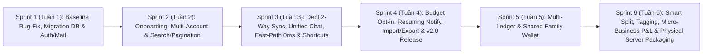

# Kế hoạch Triển khai theo Sprint (1 Tuần / Sprint) — ARC Irobot v2.1

**Nhịp Sprint**: 1 tuần / Sprint (5 ngày triển khai + kiểm thử, cuối tuần review & nghiệm thu).  
**Tổng lộ trình**: 6 Sprint (4 Sprint đầu hoàn thiện **Release v2.0 SaaS Core**; 2 Sprint sau hoàn thiện **Release v2.1 Collaboration & Pro**).

---

## Tổng quan Roadmap 6 Sprint

---

## Chi tiết từng Sprint

### Sprint 1 (Tuần 1): Ổn định Lõi, Schema Migration, Auth & Mail Baseline
- **Mục tiêu**: Diệt 100% bug ngầm của `v1.2.2`, nâng cấp schema DB đa ví/đa sổ an toàn, tích hợp Nodemailer SMTP cho Quên/Đổi mật khẩu.
- **Phạm vi**:
  - Vá schema `categories` (bỏ global unique, thêm `kind`, partial unique index), bật `PRAGMA foreign_keys = ON`.
  - Tạo các bảng lõi mới (`ledgers`, `ledger_members`, `accounts`, `user_profiles`, `auth_tokens`) và script backfill user cũ không mất dữ liệu.
  - Vá các bug API/UI: `debts/[id]` DTO, `verify/route.ts` HTTP status, `utils.ts` timezone parsing, `budgets/[id]` `PUT`, `expenses/[id]` `PUT` delta alert & `DELETE` 404, Zod validation cho `PUT` endpoints.
  - Tích hợp `src/lib/mailer.ts` (Nodemailer) + `/api/auth/forgot-password` & `/api/auth/reset-password` + Đổi mật khẩu trong Settings.
  - Dọn dẹp 8 ESLint warnings hiện tại & bổ sung integration tests cho migration + auth.
- **Tiêu chí nghiệm thu (Sprint 1 DoD)**: `tsc --noEmit`, `lint` (0 errors, 0 warnings), `pnpm test` pass 100%; test migration chạy lại nhiều lần (idempotent) trên bản sao DB thực tế không mất dữ liệu.

### Sprint 2 (Tuần 2): Onboarding Persona, Module Flags, Multi-Account & Mobile UX
- **Mục tiêu**: Đưa luồng Onboarding phân loại người dùng + Settings bật/tắt module vào hoạt động; hoàn thiện Đa ví + Chuyển khoản nội bộ + Tìm kiếm/Phân trang.
- **Phạm vi**:
  - Trang `/onboarding` (2 bước, có nút Bỏ qua) + redirect từ auth lần đầu.
  - Phần **Nhu cầu & Tính năng mở rộng** trong `/settings` + `ProfileContext` / `/api/profile`.
  - CRUD `/api/accounts` + UI quản lý ví + chọn ví khi nhập tay & trên Dashboard.
  - Hỗ trợ `type = 'transfer'` (Chuyển khoản nội bộ) ở Form nhập tay + DB + SQL summary loại trừ transfer.
  - Mở ô tìm kiếm trên mobile/tablet ở `/expenses`, thêm bộ lọc loại (`Thu/Chi/Chuyển khoản`), lọc ví, và cursor pagination (`limit = 50`).
- **Tiêu chí nghiệm thu**: User mới chọn Persona `wealth_builder` thấy ngay Multi-Account; user `speed_tracker` có giao diện tối giản; chuyển khoản giữa 2 ví không làm tăng `Tổng chi` tháng.

### Sprint 3 (Tuần 3): Unified AI Chat, Fast-Path 0ms, Debt 2-Way Sync & Shortcuts
- **Mục tiêu**: Hợp nhất `/debt-chat` vào `/chat`, tăng tốc ghi sổ đơn giản xuống `< 150ms`, đồng bộ công nợ 2 chiều với ví và mở khóa Apple Shortcuts.
- **Phạm vi**:
  - Gộp `/debt-chat` → `/chat` (redirect 308); sửa nhánh `debt` nhận ảnh, transaction, trả `receiptData`.
  - Triển khai `merchant_rules` + **Fast-Path 0ms** (`parseSimpleChatTransaction` + học tự động khi user sửa danh mục).
  - Thêm **AI Financial Q&A** (hỏi đáp số liệu thực trong `/chat`) + rút gọn timeout/fallback chain AI + hỗ trợ **Whisper** cho `openai_compatible`.
  - Công nợ 2 chiều (`payable` / `receivable`) + mặc định đồng bộ `debt_payments` ↔ `expenses` (trừ/cộng vào ví) + **Debt Payoff Simulator** (`Avalanche` vs `Snowball`).
  - Hoàn thiện Apple Shortcuts API (`/api/shortcuts/keys` + `/api/shortcuts/transactions`) + Rate Limit bảo vệ Server AI Key.
- **Tiêu chí nghiệm thu**: Câu `"ăn trưa 50k"` có lịch sử trả về `< 150ms` không gọi LLM; gửi ảnh trả nợ ở `/chat` tạo payment + trừ ví + hiện thẻ biên lai; gọi Shortcuts endpoint bằng curl/iPhone thành công.

### Sprint 4 (Tuần 4): Budget Opt-in, Recurring Notify, Offline Blob, Import/Export & Phát hành v2.0
- **Mục tiêu**: Hoàn tất các tính năng kỷ luật ngân sách (opt-in), nhắc lịch định kỳ (notify-only), thống kê Cashflow Pro, Import/Export và phát hành **v2.0**.
- **Phạm vi**:
  - Hợp nhất `src/lib/budget-evaluator.ts` dùng chung Dashboard/Budgets/Alerts; thêm widget **Safe-to-Spend hôm nay**.
  - Thêm checkbox opt-in **Rollover** trên hũ ngân sách + **Payday Auto-Split** khi ghi thu nhập.
  - CRUD `recurring_rules` + Push nhắc hẹn qua `reminders-worker.ts` (batch song song concurrency 5) + banner **Xác nhận 1 chạm** (chỉ ghi giao dịch khi user bấm duyệt).
  - Nâng cấp `offline-queue.ts` tự sync `ai_note` và lưu ảnh `Blob` offline.
  - Thống kê Cashflow Thu–Chi–Saving Rate + Runway ở `/stats`.
  - Export CSV (UTF-8 BOM), Import CSV sao kê ngân hàng & Restore JSON backup.
- **Tiêu chí nghiệm thu**: Full regression E2E trên desktop + mobile Safari PWA; chốt tag release `v2.0.0`.

### Sprint 5 (Tuần 5): Multi-Ledger & Shared Family Wallet (v2.1 Beta)
- **Mục tiêu**: Mở khóa phân khúc Gia đình / Cặp đôi và tách Sổ Kinh doanh.
- **Phạm vi**:
  - API & UI quản lý nhiều Sổ (`ledgers`: Cá nhân / Gia đình / Kinh doanh) + Switcher trên header/sidebar.
  - Luồng mời thành viên qua Email (Nodemailer) hoặc Link Token + phân quyền `owner / editor / viewer`.
  - Hiển thị `created_by` trên mỗi giao dịch sổ chung + Push notification chéo cho thành viên khi sổ chung có giao dịch mới.
- **Tiêu chí nghiệm thu**: 2 tài khoản cùng ghi vào 1 Sổ gia đình với isolation chặt chẽ (user ngoài sổ bị chặn `403`).

### Sprint 6 (Tuần 6): Smart Split, Tagging, P&L & Đóng gói hạ tầng Server Vật lý (v2.1 GA)
- **Mục tiêu**: Hoàn thiện tính năng Pro/Micro-Business và chuẩn bị hạ tầng Docker cho Server vật lý.
- **Phạm vi**:
  - **Smart Split** trong Chat AI (chia tiền nhóm tự tách phần chi cá nhân + khoản phải thu).
  - Hệ thống `#tag` + trạng thái hoàn ứng (`reimbursable`) + Báo cáo P&L gọn cho Sổ kinh doanh.
  - Tách `budgets/page.tsx` (`1.117` dòng) thành các component nhỏ dễ bảo trì.
  - Viết `Dockerfile` (Next.js standalone), `docker-compose.yml` (App + `libsql/sqld` + Cron Worker), hướng dẫn chuyển dịch Turso → Server vật lý (`docs/DEPLOY_SELF_HOST.md`).
- **Tiêu chí nghiệm thu**: Build & chạy thử trọn bộ bằng Docker Compose local thành công, toàn bộ test suite & lighthouse PWA đạt chuẩn, phát hành `v2.1.0`.
